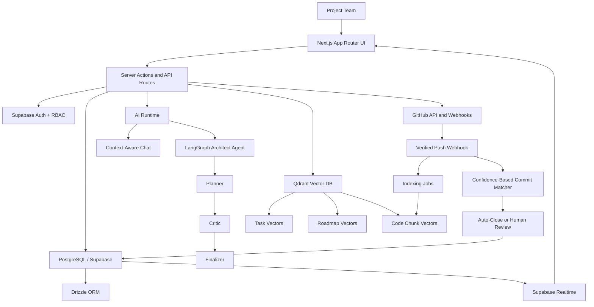

# Nexus Platform — New Semester Presentation

## An AI-Augmented Project Intelligence Platform

**Authors:** Priyam Garg, Lakshya Dhaka, Saikiran Phulari  
**Repository:** Nexus  
**Technology:** Next.js 15, TypeScript, PostgreSQL/Supabase, Drizzle, Qdrant, LangGraph

---

## Slide 01: Title

### Nexus Platform

### From AI-Augmented Project Management to Dependency-Aware Project Intelligence

Nexus unifies:

- Kanban task execution
- AI-generated roadmaps
- Context-aware project chat
- Architect Agent task decomposition
- GitHub code intelligence
- Dependency and critical-path planning
- Reliable webhook automation
- AI evaluation and operational observability

**Central message:**

> Nexus connects what the team plans, what the team builds, and what the repository actually ships.

**Suggested visual:**

```text
Roadmap + Tasks + Code
          ↓
     Shared RAG Memory
          ↓
 Chat | Agent | Board | GitHub
```

---

## Slide 02: The Project Problem

Software teams work across disconnected surfaces:

- Issue trackers contain task state.
- Roadmaps contain planned phases.
- AI assistants contain no reliable project memory.
- GitHub contains the source-code truth.
- Commits rarely update project-management state automatically.

### Consequences

- AI suggests tasks that already exist.
- Generated tasks do not understand the current codebase.
- Task status becomes stale.
- Dependencies and blockers remain implicit.
- Teams cannot easily identify the highest-impact unfinished work.
- AI automation can make decisions without confidence or review.

---

## Slide 03: Aim and Evolution

### Original Aim

Build a single platform where:

- Chat understands the project board.
- The Architect Agent understands the roadmap.
- AI can retrieve relevant source code.
- GitHub commits can write status back to the board.

### New Semester Aim

Evolve the MVP into a more reliable and measurable platform by adding:

- Explicit task dependency modeling
- Critical-path prioritization
- Stronger authorization
- Replay-safe webhook processing
- Indexing job observability and retry
- Confidence-aware AI automation
- Human review workflows
- AI evaluation records and tests

---

## Slide 04: System Architecture



---

## Slide 05: Technology Stack

### Application

- Next.js 15 App Router
- React 19
- TypeScript strict mode
- Server Actions and API route handlers

### Data and Auth

- PostgreSQL through Supabase
- Drizzle ORM
- Drizzle Kit migrations
- Supabase Auth and SSR sessions
- Supabase Realtime for task updates

### AI and Retrieval

- OpenAI-compatible chat completion interface
- Gemini embeddings
- Qdrant vector database
- LangGraph state machine
- Zod structured-output validation

### UI and Integration

- Tailwind CSS
- shadcn/ui and Radix primitives
- Zustand state management
- Framer Motion
- Recharts
- Octokit GitHub API client
- Nodemailer SMTP invitations
- Vitest automated tests

---

## Slide 06: Previous Implementation — Shared RAG Memory

Nexus uses three Qdrant collections:

| Collection | Contents |
|---|---|
| `tasks` | Task titles, descriptions, status, priority, tags |
| `roadmap` | Parsed implementation-plan sections |
| `code_chunks` | Overlapping source-code chunks with file metadata |

### Retrieval flow

```text
User query
    ↓
Generate embedding
    ↓
Qdrant cosine search
    ↓
Filter by project_id and domain metadata
    ↓
Top-k context
    ↓
AI prompt
```

Payload metadata supports filtering by:

- Project
- Task status
- Priority
- Roadmap phase
- Section type
- Filepath
- Language

---

## Slide 07: Previous Implementation — AI Surfaces

### Context-Aware Chat

Chat combines:

- Full board snapshot
- Relevant roadmap sections
- Relevant GitHub code chunks
- Conversation history

### Architect Agent

```text
START
  ↓
Planner
  ↓
Critic
  ├── needs_revision → Planner
  └── acceptable → Finalizer
  ↓
Validated task list
```

### Previous output

The agent produced:

- Task title
- Description and acceptance criteria
- Priority
- Story points
- Tags
- Architectural reasoning

---

## Slide 08: Previous Implementation — GitHub and Collaboration

### GitHub

- OAuth repository connection
- Repository selection
- Full tree indexing
- File filtering and chunking
- Gemini code embeddings
- Qdrant code retrieval
- Push webhook reindexing
- Commit-to-task matching

### Collaboration

- Owner/admin/member roles
- Invitation tokens with expiry
- SMTP invitation delivery
- Realtime Kanban task synchronization

### Previous limitation

The system had strong functionality but needed stronger guarantees around:

- Dependencies
- Authorization consistency
- Webhook replay handling
- Indexing observability
- AI decision confidence
- Automated evaluation

---

## Slide 09: Advancement 01 — Dependency-Aware Planning

### New `task_dependencies` model

```text
project_id
 task_id             → dependent task
 depends_on_task_id  → blocking task
 created_by
 created_at
```

### Validation

- No self-dependencies
- No cross-project edges
- No duplicate edges
- No cycles
- Cascade-safe deletion

### Why it matters

The old board represented status. The new board represents execution order and blockers.

```text
Database schema
      ↓
API dependency actions
      ↓
Task modal controls
      ↓
Visual graph
```

---

## Slide 10: Advancement 02 — Dependency Graph and Critical Path

### Visual graph

The board now displays dependency levels:

```text
Starting work → After level 1 → After level 2 → After level 3
```

Each node shows:

- Task title
- Status
- Story points

### Critical path

The system calculates the highest-weight unfinished dependency chain.

```text
A: 3 points
  ↓
B: 5 points
  ↓
C: 8 points

Critical path total = 16 points
```

Critical-path tasks are highlighted to show where work should be prioritized first.

---

## Slide 11: Advancement 03 — Architect Dependencies

### Previous output

The Architect Agent generated a flat task list.

### New output

The agent can return dependency indices:

```json
{
  "title": "Implement analytics API",
  "dependsOnTaskIndices": [0]
}
```

### Acceptance flow

```text
AI task index
      ↓
User selects generated tasks
      ↓
Database task IDs created
      ↓
Indices translated to IDs
      ↓
Dependency edges persisted
```

### Safety

- Invalid indices are removed.
- Only earlier tasks can be dependencies.
- Partial selection does not create dangling edges.
- Cycles are rejected by the server.

---

## Slide 12: Advancement 04 — Security and Webhook Reliability

### Authorization hardening

Membership and role checks now protect:

- Roadmap actions
- Insight actions
- GitHub actions
- Task event history

### Webhook replay protection

```text
GitHub push
    ↓
HMAC verification
    ↓
Read X-GitHub-Delivery
    ↓
Persist delivery ID
    ↓
Duplicate? Ignore safely
    ↓
Process once
    ↓
completed / failed status
```

### New event data

`github_webhook_events` records:

- Delivery ID
- Repository
- Commit SHA
- Status
- Error message
- Received and processed times

---

## Slide 13: Advancement 05 — Observable GitHub Automation

### Durable indexing jobs

`indexing_jobs` records:

- Job type
- Status
- Commit SHA
- Total files
- Processed files
- Failed files
- Error message
- Start/completion time

### BullMQ operational improvements

- GitHub pushes and manual reindex actions enqueue durable BullMQ jobs.
- Redis stores the queue and retry state.
- A separate TypeScript worker performs GitHub and Qdrant work.
- Jobs retry automatically with exponential backoff.
- Manual reindex creates a job record.
- Webhook reindex creates a job record.
- Failed jobs can be retried.
- GitHub settings displays indexing history.

### Code reindex flow

```text
Webhook or UI action
    ↓
BullMQ job in Redis
    ↓
GitHub worker
    ↓
Changed file
    ↓
Fetch from GitHub
    ↓
Filter file
    ↓
Delete old file chunks
    ↓
Chunk into 150-line windows
    ↓
Generate embeddings
    ↓
Upsert Qdrant vectors
    ↓
Update indexed-file metadata
```

---

## Slide 14: Advancement 06 — Confidence-Aware AI and Evaluation

### Confidence-based commit matching

Previous:

```json
{"taskIds": ["task-1"]}
```

New:

```json
{
  "matches": [
    {
      "taskId": "task-1",
      "confidence": 0.94,
      "reason": "The commit implements the requested API."
    }
  ]
}
```

### Decision policy

```text
≥ 90% → auto-close
< 90% → admin review
invalid → ignore
```

### AI evaluation records

Automatically captured for:

- Chat
- Architect Agent
- Commit matcher

The Insights page reports:

- Evaluation samples
- Average grounding score
- Average relevance score
- Accepted labels
- Latency and model metadata

---

## Slide 15: Redis and BullMQ Architecture

### Queue architecture

```text
GitHub webhook or Settings UI
            ↓
Create indexing_jobs record
            ↓
Typed BullMQ job
            ↓
Upstash Redis / Redis TLS
            ↓
GitHub worker process
            ↓
GitHub API + Qdrant + PostgreSQL
```

### Redis configuration

- Hosted Upstash Redis over `rediss://`
- Shared IORedis connection
- Queue name: `github-indexing`
- Job retry: 3 attempts
- Exponential backoff: starting at 5 seconds
- Worker concurrency: 2

### Key implementation files

- `src/core/queue/redis.ts`
- `src/modules/github/queue.ts`
- `scripts/github-worker.ts`
- `src/app/api/webhooks/github/route.ts`
- `src/modules/github/actions.ts`

---

## Slide 16: Redis and Queue Verification

### Verification layers

1. Redis ping returns `PONG`.
2. A BullMQ smoke job is added successfully.
3. Worker reports `[github-worker] Ready`.
4. GitHub reindex creates `queued` job state.
5. Worker changes it to `running` and then `completed` or `failed`.
6. Worker and BullMQ logs show completion or retry details.

### Commands

```bash
npm run queue:worker
npm run dev
npm run start:all
```

### Presentation evidence

- Worker-ready terminal screenshot
- Redis PING/PONG output
- BullMQ queued-job smoke test
- Indexing history in GitHub settings
- PostgreSQL `indexing_jobs` status transitions

---

## Slide 17: Redis Chat Request Queue

### Previous chat behavior

Chat completion was synchronous inside the Next.js server action.

### New queued chat flow

```text
User message
    ↓
Save in PostgreSQL
    ↓
Redis user/project rate limit
    ↓
Assemble board + roadmap + code context
    ↓
BullMQ ai-processing job
    ↓
AI worker completion
    ↓
Assistant message + metrics saved
    ↓
UI polls and reloads history
```

### Benefits

- Non-blocking chat HTTP requests
- Retryable AI completions
- Worker isolation
- Durable chat and telemetry records
- Multiple users can queue safely

---

## Slide 18: Redis Architect Task Queue

### Previous behavior

LangGraph Planner/Critic/Finalizer executed synchronously.

### New queued behavior

```text
Requirement + roadmap + tasks + code
              ↓
Architect Redis limit
              ↓
ai-processing queue
              ↓
AI worker
              ↓
Planner → Critic → Finalizer
              ↓
Zod validation
              ↓
agent_generations in PostgreSQL
              ↓
Client polling
              ↓
Generated task UI
```

### Benefits

- Expensive planning work runs outside request lifecycle
- Independent Architect rate limits
- Retryable graph execution
- Persistent generation history
- Queue status can be polled by the UI

---

## Slide 19: Redis AI-Provider and Chat Throttling

### Three Redis limit scopes

| Limit | Redis key scope |
|---|---|
| Chat | `userId + projectId` |
| Architect | `userId + projectId` |
| AI provider | Provider-wide |

### Example provider key

```text
nexus:ai-provider:gemini
```

### Protected operations

- Chat completion
- Commit matching
- Insight and narrative generation
- Architect LangGraph calls
- Other OpenAI-compatible completion calls

This prevents one project or burst of chat requests from consuming provider capacity without coordination.

---

## Slide 20: Results, Validation, and Future Work

### Current implementation results

- 18 relational tables
- 3 Qdrant collections
- Dependency graph and critical-path analysis
- Confidence-based GitHub automation
- Webhook replay protection
- Durable indexing job history and retry
- AI evaluation records and dashboard
- GitHub BullMQ queue and worker operational
- Chat BullMQ queue and worker operational
- Architect BullMQ queue and worker operational
- Redis chat, Architect, and provider-wide throttling operational
- 9 automated tests passing
- TypeScript validation passing
- Drizzle migration checks passing
- Webpack production build passing

### Honest limitations

- Evaluation scores require human labels or benchmark data.
- The graph is functional but not yet a full drag-and-drop graph editor.
- Queue monitoring can still be improved with Bull Board or another visual dashboard.
- Redis and worker availability must remain configured in every deployed environment.
- GitHub token encryption at rest remains future hardening work.
- External services are required for full runtime behavior.

### Future work

- React Flow graph editor with zoom and filtering
- Syntax-aware code chunking
- PR-level intelligence
- Encrypted GitHub tokens
- Benchmark dataset and precision/recall evaluation
- Bull Board/BullMQ dashboard
- Production deployment and observability dashboards

### Final takeaway

> Nexus now connects planning, execution, code, dependencies, automation, and evaluation in one project intelligence platform.
